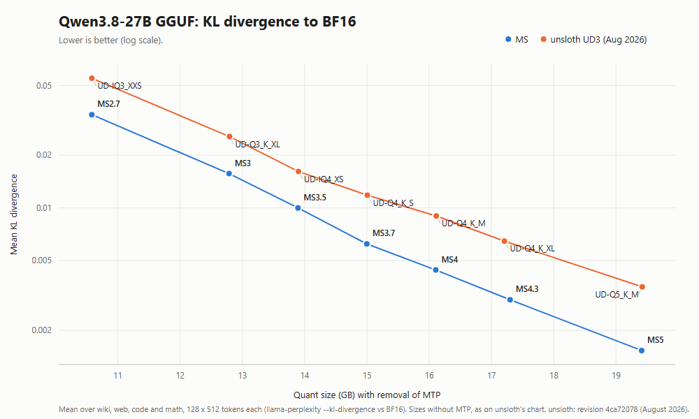
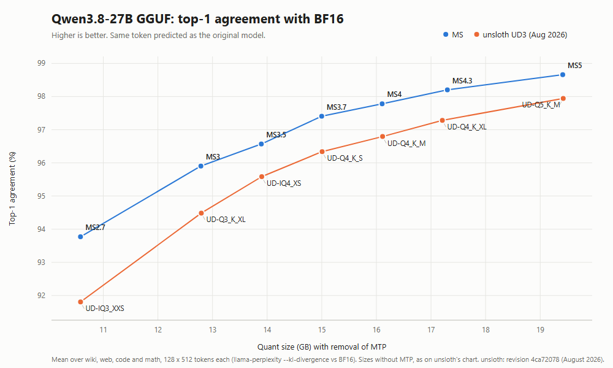
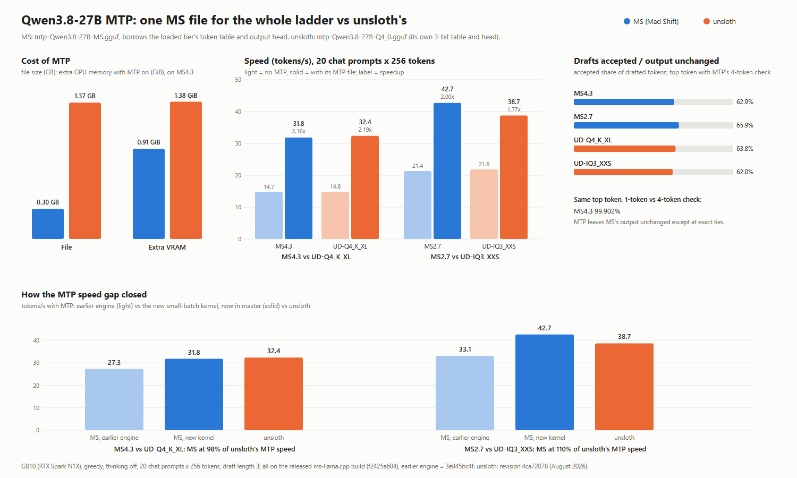

# Same size as unsloth. 1.6-2.3x lower quality loss.

**MS (Mad Shift)** quants of [Qwen3.8-27B](https://huggingface.co/devvexus/Qwen3.8-27B-MS), and **ms-llama.cpp**, the llama.cpp fork that runs them.

- **Accuracy:** 1.61-2.31x lower KL divergence than unsloth's UD3 file of the same size (1): 1.61-1.63x for MS2.7-MS3.5, 1.90-2.31x for MS3.7-MS5.
- **Top-1:** the most likely next token matches the original BF16 model's 93.8-98.7% of the time, vs 91.8-97.9% for unsloth's UD3 file of the same size: 22-35% fewer mismatches (1).
- **Speed:** generation about the same as unsloth (98-100%) (2). MTP doubles it: 2.0-2.2x faster than without MTP, MS4.3 31.8 tokens/s, MS2.7 42.7 tokens/s on an RTX Spark (3).
- **Memory:** every file no larger than its unsloth file, except MS4.3 (+0.09 GB) (1). MTP adds ~0.9 GiB; unsloth's MTP file adds ~1.4 GiB on the same file (~1.7 GiB with their own files) (3).
- **MTP:** our own MS-coded MTP file, 0.30 GB, one for every size (it borrows the loaded file's token table and output head); unsloth's is 1.37 GB. It drafts as well as unsloth's 4.5x larger MTP file and runs a little faster: on the same MS4.3 file 62.9% vs 62.5% of drafts accepted, 31.8 vs 29.7 tokens/s (3).

<sub>(1) KL divergence from the original BF16 model, mean over four English texts; top-1 = how often the quantized model's most likely next token is the BF16 model's. UD3 = Unsloth Dynamic 3, unsloth's files at revision `4ca72078` (August 2026); their sizes without their 351 MB MTP block. (2) Chat benchmark without MTP, MS and unsloth files both on ms-llama.cpp. (3) RTX Spark (GB10), 20 chat prompts x 256 tokens, greedy; unsloth's files with their own MTP file, also on ms-llama.cpp; GPU memory from nvidia-smi.</sub>







| MS file | Size | KL divergence | unsloth UD3 file | its size | its KL divergence | MS is |
|---|---|---|---|---|---|---|
| MS5 | 19.41 GB | 0.001531 | UD-Q5_K_M | 19.42 GB | 0.003539 | **2.31x** closer |
| MS4.3 | 17.30 GB | 0.002984 | UD-Q4_K_XL | 17.21 GB | 0.006457 | **2.16x** closer |
| MS4 | 16.11 GB | 0.004417 | UD-Q4_K_M | 16.11 GB | 0.008994 | **2.04x** closer |
| MS3.7 | 15.00 GB | 0.006226 | UD-Q4_K_S | 15.01 GB | 0.011821 | **1.90x** closer |
| MS3.5 | 13.89 GB | 0.010001 | UD-IQ4_XS | 13.90 GB | 0.016138 | **1.61x** closer |
| MS3 | 12.79 GB | 0.015699 | UD-Q3_K_XL | 12.80 GB | 0.025538 | **1.63x** closer |
| MS2.7 | 10.58 GB | 0.034064 | UD-IQ3_XXS | 10.58 GB | 0.055020 | **1.62x** closer |

Compared against Unsloth Dynamic 3 (UD3): unsloth's files at revision 4ca72078 (August 2026). Mean KL divergence over
English wiki, web, code and math text the files were not made from; lower is better. unsloth's sizes are without the MTP
layer built into their files. Every MS file is no larger than its unsloth file except MS4.3, which is 0.09 GB larger.
The tensors MS does not code (input embedding table, norms, small SSM tensors) are unsloth's, copied unchanged; see the
model card.
Method and per-text numbers: [model card](https://huggingface.co/devvexus/Qwen3.8-27B-MS).

## Run it now

**1. Install the engine** (Windows with an NVIDIA GPU, once). Paste into PowerShell:

```powershell
$d="$env:LOCALAPPDATA\ms-llama"; $z=if($env:PROCESSOR_ARCHITECTURE -eq "ARM64"){"arm64-cuda"}else{"x64-cuda12"}; ni -ItemType Directory -Force $d|Out-Null; curl.exe -fL -o "$d\ms.zip" "https://github.com/devvexus/ms-llama.cpp/releases/latest/download/ms-llama-win-$z.zip"; if($?){tar -xf "$d\ms.zip" -C $d}
```

It puts the prebuilt engine (x64 or ARM64, picked for you; CUDA and C++ runtimes included) in `%LOCALAPPDATA%\ms-llama`. It
never touches an existing llama.cpp.

**2. Run the file that fits your GPU.** The first run downloads it and the 0.30 GB MTP file from Hugging Face. Then a chat
page and an API run on **http://localhost:8080**. Stop with Ctrl+C; run the same line to start again.

12-16 GB (RTX 4070 Ti Super, 4080, 5070 Ti, 5080): **MS2.7**, 10.6 GB

```powershell
& "$env:LOCALAPPDATA\ms-llama\llama-server.exe" -hf devvexus/Qwen3.8-27B-MS:MS2.7 --spec-type draft-mtp --port 8080
```

24 GB (RTX 3090, 4090): **MS4.3**, 17.3 GB

```powershell
& "$env:LOCALAPPDATA\ms-llama\llama-server.exe" -hf devvexus/Qwen3.8-27B-MS:MS4.3 --spec-type draft-mtp --port 8080
```

32 GB or more (RTX 5090, RTX Spark, DGX Spark): **MS5**, 19.4 GB

```powershell
& "$env:LOCALAPPDATA\ms-llama\llama-server.exe" -hf devvexus/Qwen3.8-27B-MS:MS5 --spec-type draft-mtp --port 8080
```

On a 12 GB card, MS2.7 runs with a shorter context (the server fits it by itself). Any other file by name:
`-hf devvexus/Qwen3.8-27B-MS --hf-file MS3.7/Qwen3.8-27B-MS3.7.gguf`. A .gguf you downloaded yourself:
`-m <file>.gguf -md mtp-Qwen3.8-27B-MS.gguf --spec-type draft-mtp`.

**Linux and macOS:** build from source like llama.cpp, then run the same server with the tag for your GPU:

```bash
git clone https://github.com/devvexus/ms-llama.cpp
cd ms-llama.cpp
cmake -B build -DGGML_CUDA=ON -DCMAKE_BUILD_TYPE=Release   # CPU only (and macOS): drop -DGGML_CUDA=ON
cmake --build build --config Release -j
./build/bin/llama-server -hf devvexus/Qwen3.8-27B-MS:MS2.7 --spec-type draft-mtp --port 8080   # or :MS4.3, :MS5
```

## Use it in your apps

With the server running:

- **Claude Code:** set `ANTHROPIC_BASE_URL=http://localhost:8080` and `ANTHROPIC_AUTH_TOKEN` to any value, then start
  `claude`. The server speaks Anthropic's Messages API (`/v1/messages`).
  PowerShell: `$env:ANTHROPIC_BASE_URL="http://localhost:8080"; $env:ANTHROPIC_AUTH_TOKEN="local"; claude`
- **OpenAI-compatible apps:** base URL `http://localhost:8080/v1`, any API key.
- **Apps that run llama.cpp themselves** (they ask for a llama.cpp folder or a `llama-server` path): point them at
  `%LOCALAPPDATA%\ms-llama`.
- **Ollama:** Ollama can't load MS files itself (nor can LM Studio or stock llama.cpp). If your app can use an
  OpenAI-compatible connection instead of Ollama, give it `http://localhost:8080/v1`.

## Models

- [devvexus/Qwen3.8-27B-MS](https://huggingface.co/devvexus/Qwen3.8-27B-MS): 7 tiers, MS2.7 (10.6 GB) to MS5 (19.4 GB),
  plus one MTP file, `mtp-Qwen3.8-27B-MS.gguf` (0.30 GB, in the top folder).
- [devvexus/Qwen3.5-2B-MS](https://huggingface.co/devvexus/Qwen3.5-2B-MS).

These repositories are private until launch.

## MTP: one small file, twice the speed

One 0.30 GB MTP file, `mtp-Qwen3.8-27B-MS.gguf`, works with every tier: it holds only the MTP block and borrows the loaded
tier's token table and output head. `--spec-type draft-mtp` turns it on. The model checks every drafted token.

RTX Spark (GB10), 20 chat prompts x 256 tokens, greedy, both on ms-llama.cpp; unsloth's files with their own MTP file:

| Model + MTP file | tokens/s | speedup | drafts accepted | extra GPU memory |
|---|---|---|---|---|
| **MS4.3 + ours** | **31.8** | 2.16x | 62.9% | +0.91 GiB |
| UD-Q4_K_XL + unsloth's | 32.4 | 2.19x | 63.8% | +1.69 GiB |
| **MS2.7 + ours** | **42.7** | 2.00x | 65.9% | +0.87 GiB |
| UD-IQ3_XXS + unsloth's | 38.7 | 1.77x | 62.0% | +1.71 GiB |

With MTP on, MS4.3 runs at 98% and MS2.7 at 110% of unsloth's speed. Extra GPU memory is nvidia-smi with MTP on minus off
(GiB = 1024 MiB); unsloth's MTP file loaded with MS4.3 instead adds ~1.4 GiB.

## Speed

On the RTX Spark (GB10), both on ms-llama.cpp, against unsloth's UD3 file of the same size:

| MS file | unsloth UD3 file | generation, tokens/s (MS vs unsloth) | prompt processing |
|---|---|---|---|
| MS4.3 | UD-Q4_K_XL | 14.74 vs 14.80 (1.00x) | 0.95x |
| MS4 | UD-Q4_K_M | 15.75 vs 15.91 (0.99x) | 0.92x |
| MS3 | UD-Q3_K_XL | 19.00 vs 19.10 (0.99x) | 1.00x |
| MS2.7 | UD-IQ3_XXS | 21.36 vs 21.84 (0.98x) | 1.06x |

Generation is about the same as unsloth (98-100%): chat benchmark without MTP (20 prompts x 256 tokens, greedy). Prompt
processing: `llama-bench -p 512`, median of 3 alternating rounds; MS4 and MS4.3 are a little slower there because of a
kernel limit on that machine.

## What is MS

MS (Mad Shift) is a family of GGUF weight types (`MS_C1` ... `MS_C6`, 1 to 6 bits per weight) with its own CUDA and CPU
(x86, ARM) kernels in this fork. The files are made with QTIP's bitshift trellis + our own calibration-aware,
layer-by-layer conversion. The trellis code builds on **QTIP** (Tseng, Sun, Hou and De Sa, NeurIPS 2024,
[arXiv:2406.11235](https://arxiv.org/abs/2406.11235)). To our knowledge, MS (Mad Shift) is the first GGUF format built on
QTIP's bitshift trellis code. This repository runs MS files; format details are in
[docs/ms.md](docs/ms.md).

## Hardware

- **NVIDIA GPUs (CUDA):** supported. The Windows x64 build needs an RTX 20 series or newer card; the ARM64 build is for
  Windows on ARM with an NVIDIA GPU (RTX Spark, DGX Spark).
- **CPU (x86, ARM):** works, slower.
- **Apple Metal** and other GPU backends: not yet.

## Credit and citation

MS (Mad Shift) was created by **Matthew Priester** ([GitHub](https://github.com/devvexus),
[ORCID 0009-0000-0032-5292](https://orcid.org/0009-0000-0032-5292)). Please credit *MS (Mad Shift) by Matthew Priester*.

- How to cite: [CITATION.cff](CITATION.cff) (GitHub's "Cite this repository"). Please cite QTIP too.
- [NOTICE](NOTICE): the credit notice; keep it when you copy or adapt the MS code.
- [LICENSE](LICENSE): MIT, like llama.cpp: "Copyright (c) 2023-2026 The ggml authors" and "Copyright (c) 2026 Matthew
  Priester (MS (Mad Shift) additions)".

This project is not affiliated with or endorsed by ggml-org/llama.cpp, Qwen/Alibaba, unsloth or NVIDIA. Other product
names (Claude Code, Ollama, LM Studio and others) are trademarks of their owners, named only to describe compatibility.

We plan to propose MS for upstream llama.cpp.

---

*The original [llama.cpp](https://github.com/ggml-org/llama.cpp) README follows. Its install commands install stock
llama.cpp, which cannot load MS files; build this repository instead (see Run it now).*

# llama.cpp


<div align="center">

<b>LLM inference in C/C++</b>

[](https://opensource.org/licenses/MIT)
[](https://github.com/ggml-org/llama.cpp/releases?q=tag:v0)
[](https://github.com/ggml-org/llama.cpp/releases?q=b)
[](https://github.com/ggml-org/llama.cpp/actions/workflows/server.yml)
[](https://github.com/ggml-org/llama.cpp/actions/workflows/docker.yml)
[](https://github.com/ggml-org/llama.cpp/actions/workflows/winget.yml)

[ggml](https://github.com/ggml-org/ggml) / [ops](https://github.com/ggml-org/llama.cpp/blob/master/docs/ops.md) / [maintainer PRs](https://github.com/ggml-org/llama.cpp/issues?q=is%3Apr%20is%3Aopen%20draft%3AFalse%20(author%3Asanmai%20OR%20author%3Argerganov%20OR%20author%3AKitaitiMakoto%20OR%20author%3Adanbev%20OR%20author%3Aaldehir%20OR%20author%3Amax-krasnyansky%20OR%20author%3ACISC%20OR%20author%3Aggerganov%20OR%20author%3Aam17an%20OR%20author%3Ajhen0409%20OR%20author%3Abartowski1182%20OR%20author%3Anikwen%20OR%20author%3Ahipudding%20OR%20author%3Aravi9%20OR%20author%3AServeurpersoCom%20OR%20author%3Athelittlefireman%20OR%20author%3Apwilkin%20OR%20author%3Areeselevine%20OR%20author%3Angxson%20OR%20author%3Ajeffbolznv%20OR%20author%3Amarty1885%20OR%20author%3A0cc4m%20OR%20author%3ATitaniumtown%20OR%20author%3Aangt%20OR%20author%3AIMbackK%20OR%20author%3Aarthw%20OR%20author%3AJohannesGaessler%20OR%20author%3AORippler%20OR%20author%3Aruixiang63%20OR%20author%3Axctan%20OR%20author%3AmasterFoad%20OR%20author%3Aallozaur%20OR%20author%3AAndreas-Krebbel%20OR%20author%3Ayomaytk%20OR%20author%3Aaendk%20OR%20author%3Awine99%20OR%20author%3Agaugarg-nv%20OR%20author%3Ataronaeo%20OR%20author%3Aforforever73%20OR%20author%3Achaxu01%20OR%20author%3Alhez%20OR%20author%3AAlekseiNikiforovIBM%20OR%20author%3Anetrunnereve%20OR%20author%3Afairydreaming%20OR%20author%3Aynankani)%20sort%3Aupdated-desc) / [dev stats](https://github.com/ggml-org/llama.cpp-dev) / [lib llama API](https://github.com/ggml-org/llama.cpp/issues/9289) / [llama-server REST API](https://github.com/ggml-org/llama.cpp/issues/9291)

</div>

## Quick start

A few options to get `llama.cpp` installed on your machine:

```bash
# curl
curl -LsSf https://llama.app/install.sh | sh

# powershell
irm https://llama.app/install.ps1 | iex
```

- Visit https://llama.app and follow the instructions
- Run with Docker - see our [Docker documentation](docs/docker.md)
- Download pre-built binaries from the [releases page](https://github.com/ggml-org/llama.cpp/releases)
- Build from source by cloning this repository - check out [our build guide](docs/build.md)

Once installed:

```sh
# Download and run a model directly from Hugging Face
llama cli -hf ggml-org/Qwen3.5-0.8B-GGUF

# Launch OpenAI-compatible API server
llama serve -hf ggml-org/Qwen3.5-0.8B-GGUF
```

<table align="center">
    <tr>
        <td align="center" width=50%>
            
            <i>VLM session with <b>llama cli</b></i>
        </td>
        <td align="center">
            
            <i>Built-in web UI against <b>llama serve</b></i>
        </td>
    </tr>
<table>

## Description

The main goal of `llama.cpp` is to enable LLM (and VLM) inference with minimal setup and state-of-the-art performance on
a wide range of hardware - locally and in the cloud.

- Plain C/C++ implementation without any dependencies
- Apple silicon is a first-class citizen - optimized via ARM NEON, Accelerate and Metal frameworks
- AVX, AVX2, AVX512 and AMX support for x86 architectures
- RVV, ZVFH, ZFH, ZICBOP and ZIHINTPAUSE support for RISC-V architectures
- 1.5-bit, 2-bit, 3-bit, 4-bit, 5-bit, 6-bit, and 8-bit integer quantization for faster inference and reduced memory use
- Custom CUDA kernels for running LLMs on NVIDIA GPUs (support for AMD GPUs via HIP and Moore Threads GPUs via MUSA)
- Vulkan and SYCL backend support
- CPU+GPU hybrid inference to partially accelerate models larger than the total VRAM capacity

The `llama.cpp` project is build on top of the [ggml](https://github.com/ggml-org/ggml) library.

## Supported backends

| Backend | Target devices |
| --- | --- |
| [BLAS](docs/build.md#blas-build) | All |
| [BLIS](docs/backend/BLIS.md) | All |
| [CANN](docs/build.md#cann) | Ascend NPU |
| [CUDA](docs/build.md#cuda) | Nvidia GPU |
| [HIP](docs/build.md#hip) | AMD GPU |
| [Hexagon](docs/backend/snapdragon/README.md) | Snapdragon |
| [IBM zDNN](docs/backend/zDNN.md) | IBM Z & LinuxONE |
| [MUSA](docs/build.md#musa) | Moore Threads GPU |
| [Metal](docs/build.md#metal-build) | Apple Silicon |
| [OpenCL](docs/backend/OPENCL.md) | Adreno GPU |
| [OpenVINO [In Progress]](docs/backend/OPENVINO.md) | Intel CPUs, GPUs, and NPUs |
| [RPC](https://github.com/ggml-org/llama.cpp/tree/master/tools/rpc) | All |
| [SYCL](docs/backend/SYCL.md) | Intel GPU |
| [VirtGPU](docs/backend/VirtGPU.md) | VirtGPU APIR |
| [Vulkan](docs/build.md#vulkan) | GPU |
| [WebGPU](docs/build.md#webgpu) | All |
| [ZenDNN](docs/build.md#zendnn) | AMD CPU |

## Documentation

#### Tools

- [cli](tools/cli/README.md)
- [completion](tools/completion/README.md)
- [server](tools/server/README.md)
- [GBNF grammars](grammars/README.md)

#### Development

- [How to build](docs/build.md)
- [Running on Docker](docs/docker.md)
- [Build on Android](docs/android.md)
- [Multi-GPU usage](docs/multi-gpu.md)
- [Performance troubleshooting](docs/development/token_generation_performance_tips.md)
- [GGML tips & tricks](https://github.com/ggml-org/llama.cpp/wiki/GGML-Tips-&-Tricks)
- [XCFramework](docs/xcframework.md)
- [Completions](docs/completions.md)
- [Models](docs/models.md)
- [Release process](docs/release.md)

## Contributing

- Contributors can open PRs
- Collaborators will be invited based on contributions
- Maintainers can push to branches in the `llama.cpp` repo and merge PRs into the `master` branch
- Any help with managing issues, PRs and projects is very appreciated!
- Read the [CONTRIBUTING.md](CONTRIBUTING.md) for more information

## Acknowledgements

- [yhirose/cpp-httplib](https://github.com/yhirose/cpp-httplib) - Single-header HTTP server, used by `llama-server` - MIT license
- [nothings/stb](https://github.com/nothings/stb) - Single-header image format decoder, used by multimodal subsystem - Public domain
- [nlohmann/json](https://github.com/nlohmann/json) - Single-header JSON library, used by various tools/examples - MIT License
- [mackron/miniaudio](https://github.com/mackron/miniaudio) - Single-header audio format decoder, used by multimodal subsystem - Public domain
- [sheredom/subprocess.h](https://github.com/sheredom/subprocess.h) - Single-header process launching solution for C and C++ - Public domain
